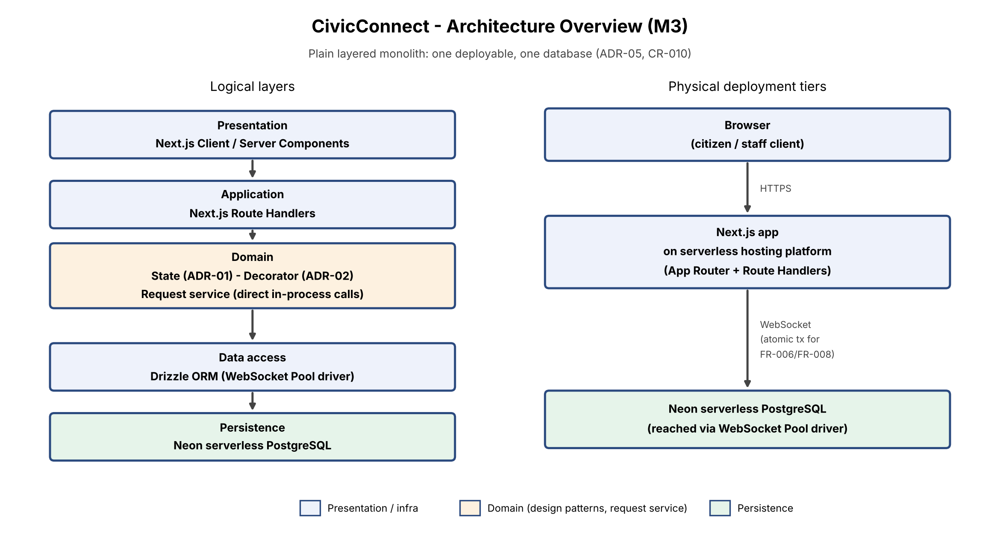

# System Architecture and Design

## High level architecture overview

Logical layers: Presentation (Next.js Client/Server Components) -\>
Application (Next.js Route Handlers) -\> Domain (State pattern for the
request lifecycle, Decorator pattern for audit logging, and the request service that applies each change and its audit row in one transaction) -\>
Data access (Drizzle ORM) -\> Persistence (Neon serverless PostgreSQL).

Physical deployment: Browser -\> Next.js application on a serverless
hosting platform -\> Neon PostgreSQL, reached over the Neon WebSocket
Pool driver so that FR-006/FR-008 can run as one atomic, interactive
transaction (status update + audit insert + optimistic-concurrency check
on a version column).

Architectural style: a plain layered monolith. CivicConnect is built as one deployable Next.js application, organised into logical layers and, inside them, by feature area (requests, staff workflow, auth, audit), with a single PostgreSQL database. No domain modules are enforced and there is no event bus, mediator or handler; a feature may call another feature's service in-process. Serverless hosting is the deployment target for that one deployable and is not a decision to build separate services. The style was revised from a modular monolith by [CR-010](../change/change-control.md). The alternatives (SOA/microservices, an event-driven design with a broker, and function-per-feature serverless), the trade-offs and the conditions for reconsidering are recorded in [ADR-05](../decisions/0008-architectural-style-plain-layered-monolith.md).

| Concern            | Technology                                                                           | Why (traces to)                                                                                                                                               |
| ------------------ | ------------------------------------------------------------------------------------ | ------------------------------------------------------------------------------------------------------------------------------------------------------------- |
| Frontend + backend | Next.js 16 (App Router, Route Handlers), TypeScript, React 19                        | Single-language stack for a 3-person team; NFR-003 mobile-first, NFR-001 performance                                                                          |
| Database           | Neon serverless PostgreSQL (free tier)                                               | Cost/Resources constraint; scale-to-zero fits a student-project budget                                                                                        |
| ORM / DB access    | Drizzle ORM + drizzle-kit, @neondatabase/serverless WebSocket Pool driver            | SQL-level control, small serverless footprint; Pool driver required for the atomic FR-006/FR-008 transaction (HTTP driver cannot do interactive transactions) |
| Feature coupling   | Direct in-process function calls within one deployable (no event bus or broker)      | ADR-05 (style); ADR-03 superseded by CR-010. One in-process call needs no broker                                                                              |

## Architecture Diagram

_Figure 1: CivicConnect logical layers (left) versus physical deployment
tiers (right). The two are kept distinct per the
proportional-architecture guidance: the logical view shows where the
State (ADR-01) and Decorator (ADR-02) patterns sit in the domain layer,
and the deployment view shows there are only two physical tiers
(serverless app, managed database) rather than a distributed set of
services, which the team's size and the ASRs above do not justify. The
architectural style this view illustrates is decided in ADR-05._

## Initial API / Integration Decision

Under the plain monolith there is no module-to-module integration to design: features call each other's services in-process ([ADR-05](../decisions/0008-architectural-style-plain-layered-monolith.md), CR-010). Department routing needs no call at all: each category belongs to one department, so a request's department is read through its category ([ADR-03](../decisions/0006-direct-in-process-routing-call.md), CR-013). Other integrations (e.g. any future external/public API) are not yet established and are left as a forward engineering consideration (FEC) instead of being invented here.

- Mechanism: direct in-process function calls inside one database transaction, not events, a broker or a network API. A2 compared this against an asynchronous message broker and a synchronous REST call; both were rejected for M2 because a network boundary between parts of the same application is not justified by CivicConnect's current scale, and would add operational complexity with no corresponding benefit yet.

- Validation / error behaviour: creating a request saves the request and its first audit row in one transaction (`createRequest` in `lib/db/queries/requests.ts`); staff actions do the same for the change and its audit row (see Staff Workflow API below). If either write fails, both roll back.

- Security boundary: none required inside the process - these calls never leave the server, so there is no network-facing surface to authenticate separately from the request that triggered them.

- Change/version implications: no wire contract or event contract exists between internal parts. If a future milestone extracts a part behind an API, revisit ADR-05 (see its reconsider triggers).

## Authentication and Session Design

Added on 13 October 2026 (authentication branch). Decision: [ADR-06](../decisions/0009-signed-cookie-sessions-with-jose.md). Scope: [CR-009](../change/change-control.md). Risk: R-13.

- Where it lives: everything about identity is in `civic-connect/lib/auth/` so a flaw can be reviewed in one place. `password.ts` hashes and verifies passwords (scrypt from Node's crypto module). `session.ts` creates and checks the signed session token and reads and writes the cookie. `guard.ts` turns the cookie into the current user and checks roles. `client.ts` is the browser helper the sign-in and sign-up forms use.

- Routes: `POST /api/auth/register` (always creates a requester), `POST /api/auth/login`, `POST /api/auth/logout`. Staff and manager accounts are created by the seed script only.

- Session: after a successful sign-up or sign-in the server sets one cookie (`civicconnect_session`): HTTP-only, SameSite=Lax, Secure in production, valid for 8 hours. It holds a token signed with `SESSION_SECRET` (HS256, via the `jose` library) that carries the user id and role.

- Authorisation: every protected route handler calls `requireRole(...)` first. The guard verifies the token, then loads the user from the database and uses the role stored there, not the role inside the token. It answers 401 when nobody is signed in and 403 when the role is not allowed. The screens (`SessionProvider`, `RoleGate`, header) only decide what to show; the API is what enforces access.

- Security boundary: unlike the in-process routing call above, this is a network-facing boundary. The same response is returned for an unknown email and a wrong password, and the password hash is never returned by any route.

- Known limits: no login rate limiting and no way to revoke a single session (technical debt register TD-01 and TD-02).

## Staff Workflow API

Added on 16 October 2026 (staff branch). Scope: FR-004 to FR-006 and FR-008; [CR-011 to CR-014](../change/change-control.md); decisions [ADR-01](../decisions/0004-state-pattern-service-request-lifecycle.md) and [ADR-02](../decisions/0005-decorator-pattern-audit-logging.md).

| Route (all `POST`) | Who may call it | Body | Effect | Audit action | Error answers |
|---|---|---|---|---|---|
| `/api/requests/[trackingId]/assign` | staff, manager, admin | `assigneeId`, `version` | Assigns or transfers the request to a staff account. Submitted becomes Assigned; an open request keeps its status when transferred | `assigned` or `transferred` | 400 missing field, 401, 403, 404, 409 version conflict, 422 (Resolved or Closed, assignee is not staff, already assigned to that person) |
| `/api/requests/[trackingId]/unassign` | staff (own requests only), manager, admin | `version` | Returns an Assigned or In progress request to Submitted with nobody assigned | `unassigned` | 400, 401, 403 (staff on someone else's request), 404, 409, 422 (not assigned, Resolved or Closed) |
| `/api/requests/[trackingId]/status` | staff, manager, admin | `status`, `notes` (optional), `version` | Moves the request to its next step only; resolving needs notes; Closed is final | the new status | 400, 401, 403, 404, 409, 422 |

- Shared handling: `handleRequestAction` in `lib/requests/actionRoute.ts` calls `requireRole("staff", "manager", "admin")` first, checks the body is a JSON object with an integer `version`, runs the action and turns `RequestActionError` codes into 404, 409, 422 or 403. On success it returns the updated request.
- Rules live in `lib/requests/service.ts` (`assignRequest`, `unassignRequest`, `advanceRequest`) and `lib/states/`. Only accounts with the staff role can be assignees, so managers and admins can assign but never hold a request (CR-012).
- Concurrency (R-10): each update is guarded by `WHERE id = ? AND version = ?` and increments `version`; a second writer gets 409 and the screen asks for a reload.
- Audit (FR-008): `logAuditAction(tx, ...)` writes the audit row inside the same transaction as the change (CR-014). The database also rejects UPDATE, DELETE and TRUNCATE on `audit_logs`.
- Progress timeline: `buildHistory` in `lib/db/queries/requests.ts` builds a request's status history from its audit rows, and an `unassigned` entry steps it back to Submitted. The requester page, the public tracking page and the staff screen all use it.
- Screens: `/queue` (Unassigned), `/queue/mine` (My requests, staff only), `/queue/all` (All requests) and `/queue/[trackingId]` (request workspace). Each page checks the role on the server and the API enforces access; the screens only decide what to show.
