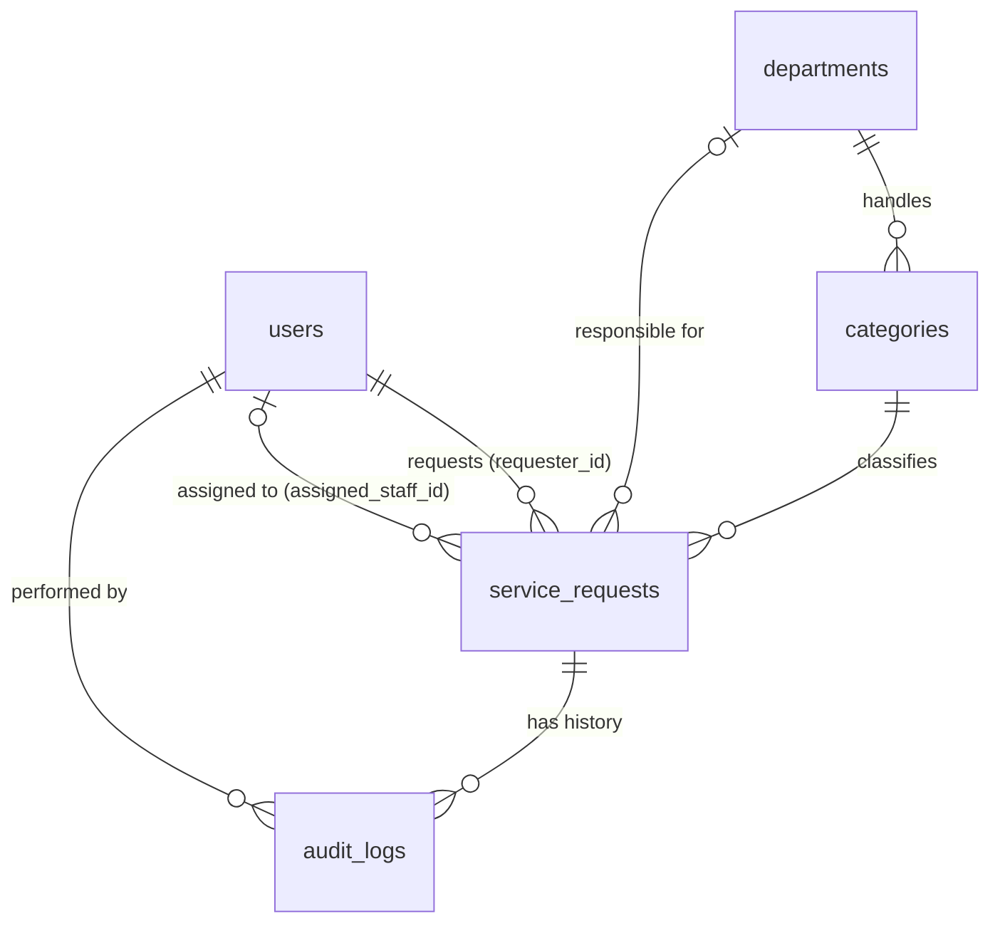

# Data and Persistence Baseline

**Status: initial baseline for Milestone 2 (October 2026).** Written against the schema in `civic-connect/lib/db/schema.ts`, ADR-04 (stack) and ADR-05 (architectural style) in the PED, and brief section 5.4. Sections marked *planned* describe intended design that is not yet implemented. Updated on 13 October 2026 for the authentication branch (password hashes, sessions, role checks) and to record that audit immutability is now enforced by the database (migration 0001).

## 1. Entities, relationships, ownership and lifecycle

| Entity (table) | Purpose | Owning module | Lifecycle |
|---|---|---|---|
| `users` | Requesters, staff, managers, admins (`role` enum). Holds personal data (name, email) and the password hash. | Access control (cross-cutting) | Requesters are created by self sign-up (CR-009); staff and manager accounts are seeded; retained while the account is active. |
| `categories` | Reference list of request types. Each category maps to one department (CR-006). | IssueManagement | Rarely changes; set by the seed script (no administrator screen in M3). |
| `departments` | Reference list of responsible departments. | RoutingAndAssignment | Rarely changes; set by the seed script (no administrator screen in M3). |
| `service_requests` | The core aggregate: one citizen request with location (free text), status, department, assignment and resolution notes. | IssueManagement (create, status); RoutingAndAssignment (assignment fields) | submitted -> assigned -> in_progress -> resolved -> closed. Never hard-deleted; `closed` is a state, not a deletion. |
| `audit_logs` | Append-only history of actions on a request (who, what, when). | Audit (Decorator, ADR-02) | Written on every significant action; never updated. |

Ownership rule (ADR-05): modules communicate through in-process domain events and call the data-access layer; they do not read each other's tables directly.

## 2. Why relational PostgreSQL is proportionate

Reasoning chain (Week 2, SO8): evidence -> concern -> decision -> trade-off -> judgement.

- **Evidence.** The data is structured and strongly related (requests link to users, a category, a department and an audit trail). FR-006 and FR-008 need a status change and its audit record to commit together. The data includes personal information (POPIA, NFR-004). Reads are mostly lookups by tracking ID and filtered staff queues; volume is small and growth is modest for a municipal service desk.
- **Concern.** Integrity and atomicity matter more than flexible structure or raw read speed.
- **Decision.** One relational store (PostgreSQL on Neon, ADR-04) accessed through Drizzle. No document, key-value or graph store, no cache, no object storage at this stage.
- **Trade-off.** We give up schema flexibility and horizontal scaling headroom. We avoid the deployment, monitoring, backup and skills burden of a second store (polyglot persistence is only justified when distinct requirements demand it).
- **Judgement.** Relational is the simplest option that satisfies the important requirements. Caching and extra stores are introduced only if measured load justifies them (revisit trigger in ADR-05).

## 3. Integrity, consistency and concurrency

- **Declared constraints (implemented):** primary keys, NOT NULL on required fields, foreign keys on all relationships, unique `users.email` (the index is case-sensitive, so the application trims and lowercases every email before it is stored or compared, and a duplicate that slips past the check is caught through Postgres error 23505), unique `service_requests.tracking_id`, unique category and department names, `categories.department_id` foreign key to `departments`, enum types for `role` and `status`.
- **Transaction boundary (planned, ADR-04):** a status update on `service_requests` and the matching `audit_logs` insert run in one interactive transaction using the Neon WebSocket Pool driver. If either fails, both roll back. Domain-event handlers that write to the database take part in the same transaction (ADR-03).
- **Concurrency (partly implemented):** `service_requests.version` exists for optimistic concurrency. Planned behaviour: update with `WHERE id = ? AND version = ?`, increment `version`, and return a conflict error if no row matched (risk R-10).
- **Current versus historical state:** `service_requests` holds the current state; `audit_logs` holds the history. Current assignment fields are overwritten on reassignment, and the audit entry preserves what was true at the time.
- **Validation split (planned):** business rules (for example, resolution notes required to resolve, FR-006) live in the State pattern classes; structural rules live in database constraints.

## 4. Sensitivity and security consequences

- **Personal data:** `users.name`, `users.email`, and request `title`, `location` and `description` can identify a person or their address. These are personal information under POPIA (NFR-004).
- **Least privilege (partly implemented):** role-based checks (`requester`, `staff`, `manager`, `admin`) are enforced in the application layer by `requireRole()` in `lib/auth/guard.ts`, which reads the user's role from the `users` table on every request and does not trust the role stored in the session cookie. It is applied to data routes as they are built. Planned: the application connects with a database role that has no schema-change rights, and the public tracking lookup returns only a minimal status view (a read-only DTO, not the full row).
- **Passwords (implemented):** `users.password_hash` holds an scrypt hash (random 16-byte salt, 64-byte key) and nothing else about the password. The hash is never returned by any route; the login lookup is the only query that selects it.
- **Sessions (implemented):** there is no sessions table. A session is a signed token in an HTTP-only cookie (ADR-06), so nothing about sessions is stored in the database. Consequence: a single session cannot be revoked; see TD-02 in the technical debt register.
- **Secrets:** the connection string (`DATABASE_URL`), the session signing secret (`SESSION_SECRET`) and the seed passwords (`SEED_*`) are read from environment variables and not committed (`.env.example` documents the names with placeholders only).
- **Encryption:** data is encrypted in transit (TLS to Neon). Field-level encryption of personal data is *planned* and not yet implemented; the RTM marks NFR-004 as "In Development" for this reason.
- **Backups are sensitive too:** restored or exported copies carry the same personal data and need the same protection.

## 5. Single point of failure, availability, backup and recovery

- **Single point of failure.** The application tier is stateless and can be re-run anywhere, but every critical operation depends on one Neon database. If it is unavailable, the service is unavailable, however healthy the application tier is. We accept this at M2 and do not add replication or failover: it would add synchronisation and operational cost that NFR-002 (>99% uptime during operating hours) and a student budget do not justify.
- **Evidence used (Neon plans page, checked 11 October 2026; re-check before relying on it):**
  - Free plan: 1 GB storage per project, 100 CU-hours per month, compute suspends after 5 minutes idle (cannot be disabled).
  - Free plan restore window: 6 hours of history (instant restore).
- **Consequences.**
  - Cold start after idle can break NFR-001 (R-07); the CU-hour cap can stop the database (R-08).
  - Recovery from accidental data loss is only possible within about 6 hours on the free plan. That is acceptable for development and demo data, and **not** acceptable for real citizen data.
- **Recovery approach for M2.**
  - What must be recoverable: `service_requests` and `audit_logs` first, then `users`; reference tables can be re-seeded.
  - Tolerable loss: for demo data, up to the restore window; for real use this must change (see below).
  - Planned: keep a seed script for reference data and a periodic `pg_dump` export stored outside Neon, protected as in section 4.
- **Retention.** Audit records are kept for the life of the request record because FR-008 requires an unchangeable history. Requests are closed, not deleted. A formal retention period and disposal rule for personal data is *not yet defined* and is recorded as a forward consideration.
- **Trigger to revisit.** If the system is to hold real personal data, move to a paid plan with a longer restore window before go-live (extends R-07/R-08 mitigation).

## 6. Scalability and growth

Expected volume is low (a request is a single row plus a few audit rows). A single PostgreSQL instance is more than sufficient for foreseeable load. The first likely bottlenecks are not database size but (a) connection handling from serverless functions (R-09) and (b) cold start (R-07). Unique indexes already cover the public tracking lookup. Secondary indexes for the staff queue (`assigned_staff_id`, `status`) are *planned* when FR-004 is implemented, driven by the actual query, not added speculatively.

## 7. Known gaps in the current schema (honest list)

1. **Audit immutability (resolved at database level, residual gap).** Migration `0001_audit_immutable.sql` adds triggers that reject UPDATE, DELETE and TRUNCATE on `audit_logs`. A database owner could still drop the trigger. Planned: also revoke UPDATE/DELETE on `audit_logs` from the application role.
2. **Audit entries do not record old and new status.** They hold `action` and `notes` only. Planned: add structured fields if reporting needs them.
3. **No secondary indexes yet** for the staff queue (see section 6).
4. **No `ON DELETE` behaviour declared** on foreign keys. Because records are closed rather than deleted this is low risk, but it should be stated explicitly when migrations are added.
5. **Personal-data encryption and retention rules** are planned, not implemented (sections 4 and 5).

## 8. Decisions and risks recorded

- Related decisions: ADR-03 (events share the transaction), ADR-04 (stack and Pool driver), ADR-05 (modular monolith, single database), ADR-06 (signed-cookie sessions), ED-04, ED-05 and ED-07 in the Decision Log.
- Related risks: R-07 (cold start), R-08 (free-tier compute cap), R-09 (connection pool), R-10 (concurrent updates), R-11 (POPIA controls), R-13 (hand-written sign-up and sign-in).
- RTM: NFR-004 and FR-008 rows reference `lib/db/schema.ts`; their status stays accurate to what is implemented.
